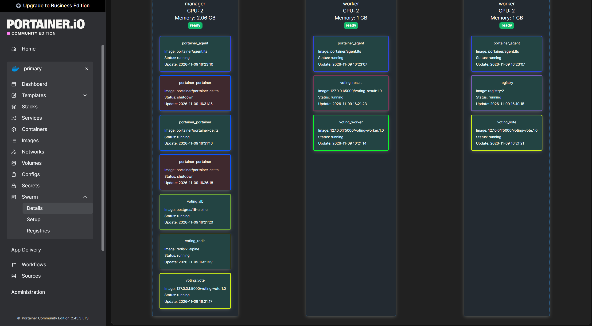
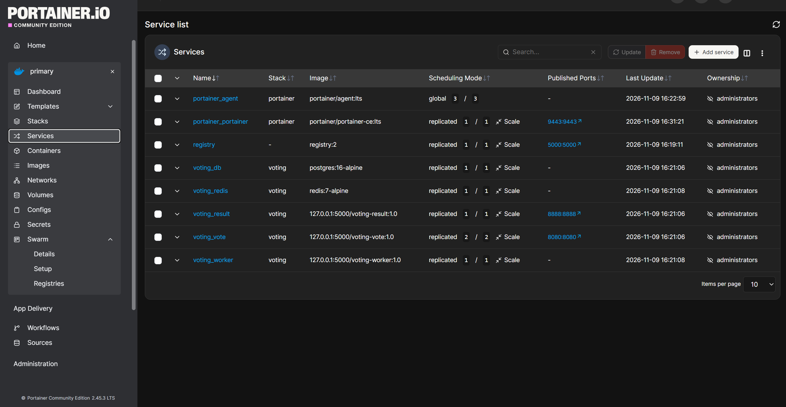

# Voting App : conteneurisation et déploiement Docker Swarm

## 1. Présentation

```
vote (Flask, 8080) ──► redis ──► worker (.NET) ──► db (Postgres) ◄── result (Node, 8888)
```

Versions imposées par les développeurs : Python 3.11, Node.js 18, .NET 7.

| Fichier | Rôle |
|---|---|
| `*/Dockerfile`, `*/.dockerignore` | images des 3 modules |
| `docker-compose.yml` | lancement local |
| `docker-stack.yml` | déploiement Swarm |
| `Vagrantfile` | les 3 nœuds du cluster |
| `.env.example` | modèle des variables Postgres |

## 2. Lancement (Docker Compose)

```bash
cp .env.example .env    # renseigner POSTGRES_USER, POSTGRES_PASSWORD, POSTGRES_DB
docker compose up -d --build
```

- vote : http://localhost:8080
- résultats : http://localhost:8888

## 3. Étape 1 : Dockerfiles

- Images légères à version fixée : `python:3.11-slim`, `node:18-alpine`, `dotnet/runtime:7.0`.
- Worker en **multi-stage** (build SDK, exécution runtime seul).
- Dépendances copiées avant le code (cache des couches), `npm ci --omit=dev`, `pip --no-cache-dir`.
- `.dockerignore` dans chaque module, `WORKDIR`, **utilisateur non-root**, `CMD`/`ENTRYPOINT` en forme exec.
- Aucun secret dans les images.

`worker` et `result` démarrent via `docker-entrypoint.sh` : si `DB_PASSWORD_FILE` est défini (Swarm), le script lit le secret dans `DB_PASSWORD`, puis `exec "$@"`. Avec Compose, il ne fait rien. `.gitattributes` force LF sur les `.sh`.

## 4. Étape 2 : scripts

Le dossier `run/` est **supprimé**. `step-1` à `step-5` sont remplacés par les services du compose, et `reset.bash` par `docker compose down -v`.

## 5. Étape 3 : Docker Compose

| | |
|---|---|
| **Réseaux** | `vote-net` (vote, redis, worker) et `result-net` (worker, db, result) : `vote` ne voit pas la base, `result` ne voit pas Redis |
| **Volumes** | `postgres_data`, `redis_data` (Redis en `--appendonly yes`) |
| **Healthchecks** | redis (`redis-cli ping`), db (`pg_isready`), vote (Python), result (`wget`) |
| **Dépendances** | `depends_on` + `condition: service_healthy` |
| **Échecs** | `restart: unless-stopped` ; worker et result réessaient aussi la connexion |
| **Ports** | seuls 8080 et 8888 sont publiés ; Redis et Postgres restent internes |
| **Secrets** | identifiants dans `.env` (ignoré par Git), aucun en dur |

## 6. Étape 4 : cluster Swarm

### Cluster

3 VM Ubuntu 22.04 (Vagrant, provider VMware, box `bento/ubuntu-22.04`, Docker installé au provisioning) :

| Nœud | Rôle | IP |
|---|---|---|
| manager | manager | 192.168.99.10 |
| worker1 | worker | 192.168.99.11 |
| worker2 | worker | 192.168.99.12 |

```bash
vagrant up
vagrant ssh manager
docker swarm init --advertise-addr 192.168.99.10
```

`--advertise-addr` est nécessaire : l'interface NAT de Vagrant est identique sur les 3 VM.

Sur `worker1` et `worker2` :

```bash
docker swarm join --token <TOKEN> 192.168.99.10:2377
```

### Images

Registre privé dans le cluster, joignable sur `127.0.0.1:5000` depuis chaque nœud via le routing mesh :

```bash
docker service create --name registry --publish 5000:5000 registry:2
cd /vagrant
docker build -t 127.0.0.1:5000/voting-vote:1.0 ./vote     && docker push 127.0.0.1:5000/voting-vote:1.0
docker build -t 127.0.0.1:5000/voting-result:1.1 ./result && docker push 127.0.0.1:5000/voting-result:1.1
docker build -t 127.0.0.1:5000/voting-worker:1.1 ./worker && docker push 127.0.0.1:5000/voting-worker:1.1
```

### Différences avec le compose (`docker-stack.yml`)

| Compose | Stack |
|---|---|
| `build:` | `image:` du registre |
| `restart:` | `deploy.restart_policy` |
| `depends_on` | retiré (ignoré par Swarm) |
| réseaux bridge | réseaux `overlay` |
| — | `vote` en 2 répliques (`result` reste à 1 à cause de socket.io) |
| volumes locaux | `db` et `redis` contraints sur le manager |
| mot de passe dans `.env` | **Docker secret** `db_password` |

### Secret

```bash
read -rs PASS; printf '%s' "$PASS" | docker secret create db_password -; unset PASS
```

- `db` le lit via `POSTGRES_PASSWORD_FILE`.
- `worker` et `result` le lisent via `DB_PASSWORD_FILE` (script d'entrée).
- Le secret est déclaré `external: true` dans la stack.

### Déploiement

L'utilisateur et le nom de la base restent dans `.env`, que `docker stack deploy` ne lit pas :

```bash
set -a; . <(tr -d '\r' < .env); set +a
docker stack deploy -c docker-stack.yml voting
docker stack ps voting
```

Accès : http://192.168.99.10:8080 et http://192.168.99.10:8888.

### Résultat

Répartition des services sur les 3 nœuds (Portainer CE, déployé avec `portainer-stack.yml`) :





## 7. Modifications du code source

Aucune fonctionnalité n'est modifiée : seule la configuration de connexion change.

| Fichier | Modification |
|---|---|
| `vote/app.py` | hôte Redis lu dans `REDIS_HOST` |
| `result/server.js` | connexion lue dans `DB_HOST`, `DB_USER`, `DB_PASSWORD`, `DB_NAME` ; mot de passe en dur supprimé |
| `worker/Program.cs` | idem, plus `REDIS_HOST` (y compris dans les reconnexions) |

`localhost` reste la valeur par défaut pour les hôtes, mais il n'y a aucune valeur par défaut pour le mot de passe.

## 8. Historique Git

[Dépôt GitHub](https://github.com/ErbLoic/votingapp)

| Commit | Contenu |
|---|---|
| `cc695a0` | init : code d'origine |
| `8b4c766` | Dockerfiles et docker-compose.yml |
| `b566d26` | bonnes pratiques Docker et gestion des secrets |
| `c8b9694` | volume Redis |
| `Last` | Swarm, Vagrantfile, documentation |
